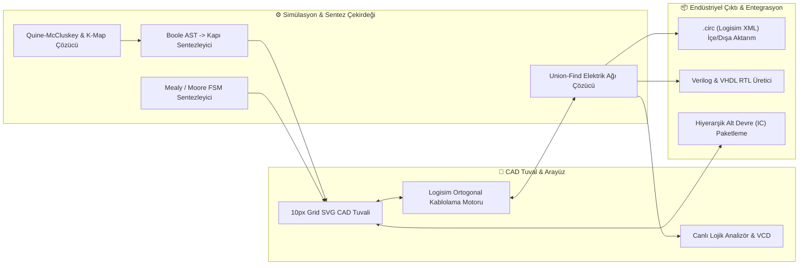

<div align="center">

# ⚡ LogicDesign Studio
### **Sıfırdan İşlemciye — Dijital Mantık Devre Tasarımı, EDA Şematik Çizim & Gerçek Zamanlı Donanım Simülasyon Platformu**

[](https://react.dev/)
[](https://www.typescriptlang.org/)
[](https://vitejs.dev/)
[](https://tailwindcss.com/)
[](https://safaksahinn.github.io/logic-design-web/)
[](https://www.electronjs.org/)
[](#)

<p align="center">
  <b>Temel mantık kapılarından 4-Bit SAP-1 mikroişlemci mimarilerine, 8-Bit Chiptune ses synthesizer'larından 16x16 RGB VRAM GPU ekranlarına kadar her seviyedeki sayısal sistemi tasarlayın, simüle edin ve FPGA (Verilog / VHDL) koduna dönüştürün.</b>
</p>

---

### 🚀 **Canlı Uygulama (Live Web App):** [https://safaksahinn.github.io/logic-design-web/](https://safaksahinn.github.io/logic-design-web/)

[🌐 **Web Kaynak Kodu (logic-design-web)**](https://github.com/SafakSahinn/logic-design-web) • [🖥️ **Masaüstü Uygulaması (logic-design-studio)**](https://github.com/SafakSahinn/logic-design-studio) • [🚀 **Canlı Demo**](https://safaksahinn.github.io/logic-design-web/)

</div>

---

## ✨ Neden LogicDesign Studio?

**LogicDesign Studio**, bilgisayar mühendisliği ve elektrik-elektronik mühendisliği düzeyindeki **Sayısal Tasarım (Digital Logic Design)** eğitimini ve donanım prototiplemesini modern bir CAD ortamında birleştirir:

- **Logisim Standardında 10px Ortogonal Kablolama Motoru (`WireRepair`):** Gerçek zamanlı kolineer birleştirme (`doMerges`), kesişim bölme (`doSplits`), kablo kısaltma/uzatma, akıllı pin çevresi dolanımı ve yalnızca gerçek 3+ yollu T-kavşaklarda lehim noktası (solder dot) oluşturan Union-Find tabanlı ağ çözümleyici.
- **36+ Donanım Bileşeni & Entegre Devre (74HC / 74LS Serisi):** Mantık kapıları, Flip-Flop'lar, 74HC181 ALU, 74HC85 Karşılaştırıcı, 74HC194 Evrensel Kaydırmalı Yazmaç, 74HC189 16x4 RAM, 16x4 ROM, 7-Segment, 8x8 Matris ve 16x16 RGB GPU.
- **Otomatik Sentez & Mühendislik Analiz Araçları:** Quine-McCluskey ve Karnaugh Haritası (K-Map) minimizasyonu, Boole cebri ifadesinden otomatik şematik çizimi, Sonlu Durum Makinesi (FSM) sentezleyici, çok kanallı lojik analizör (VCD çıktılı) ve FPGA Verilog/VHDL RTL üreticisi.

---

## 🧩 Sistem Mimarisi



---

## 🛠️ Öne Çıkan Özellikler

### 1. 📐 Logisim Uyumlu Ortogonal Kablolama & CAD Tuvali
| Özellik | Açıklama |
| :--- | :--- |
| **Yön Kilitli L-Büküm Çizimi** | İlk fare hareket yönüne göre (`Yatay-İlk` veya `Dikey-İlk`) 90° dik açılı, 10px ızgaraya tam kilitli serbest kablo çekimi. |
| **Otomatik `WireRepair` Normalizasyonu** | Üst üste binen veya aynı doğrultudaki komşu kabloları tek bir segmentte birleştirir (`doMerges`), kablo ucu geri çekildiğinde kabloyu kısaltır. |
| **Akıllı Pin Çevresi Dolanımı** | Bir kapının ikinci girişine (`B`) kablo çekerken üstteki giriş pini (`A`) üzerinden geçip kısa devre yapmasını otomatik önler. |
| **Gerçek Lehim Noktaları (Solder Dots)** | Tıpkı Logisim'de olduğu gibi köşe dönüşlerinde (2 segment) veya teğet geçişlerde nokta koymaz; yalnızca $\ge 3$ segmentin birleştiği gerçek T/4-yollu kavşaklarda lehim noktası oluşturur. |
| **Elastik Bileşen Taşıma** | Bileşenler taşındığında bağlı kablolar kopmadan ortogonal köşelerini kaydırarak yeni konuma uyum sağlar. |
| **Çoklu Sayfa (Multi-Sheet) & Alt Devre (IC)** | Projeleri sekmeli çalışma sayfalarına bölün ve herhangi bir sayfayı özel entegre çip (`Custom IC`) olarak paketleyip kullanın. |

---

### 2. 🔌 Donanım Bileşen Katalogu (36+ Modül)

| Kategori | Bileşenler |
| :--- | :--- |
| **🟢 Giriş Birimleri** | Anahtar (`Switch`), Anlık Buton (`Pushbutton`), 4-Bit DIP Anahtar (`DIP Switch`), Saat Üreteci (`Clock 0.5Hz–8Hz`), `VCC (1)`, `GND (0)`, 7-Bit `ASCII Klavye Terminali` |
| **🔵 Mantık Kapıları** | `AND`, `OR`, `NOT`, `NAND`, `NOR`, `XOR`, `XNOR` (2–5 girişli yapılandırılabilir), 3 Durumlu Tampon (`Tri-State Buffer`), Kablosuz `Tünel (Tunnel)` |
| **🟣 Kombinasyonel Entegreler** | Yarım/Tam Toplayıcı (`Half/Full Adder`), Yarım/Tam Çıkarıcı (`Half/Full Subtractor`), `2:1 / 4:1 / 8:1 MUX (74HC151)`, `1:2 / 1:4 DEMUX`, `2:4 / 3:8 Decoder (74HC138)`, `BCD to 7-Seg (74LS47)`, `4:2 Priority Encoder (74HC148)`, `4-Bit Karşılaştırıcı (74HC85)`, `4-Bit ALU (74HC181)`, `4-Bit Veri Yolu Ayırıcı (Splitter)` |
| **🟠 Ardışıl Devre & Bellekler** | `D Flip-Flop`, `JK Flip-Flop`, `T Flip-Flop`, `SR Latch`, `4-Bit Senkron Sayaç (74HC161)`, `4-Bit Paralel Yazmaç (Register)`, `4-Bit Evrensel Kaydırmalı Yazmaç (74HC194)`, `16x4 RAM (74HC189)`, `16x4 ROM` |
| **🔴 Çıkış & Multimedya** | `5mm LED`, `Mantık Probu`, `4-Bit LED Bar`, `7-Segment Ekran`, `4-Bit Hex Gösterge (0-F)`, `8-Bit Chiptune Piezo Buzzer`, `8x8 LED Nokta Matris (GPU)`, `16x16 RGB VRAM Video Ekranı` |

---

### 3. 🧪 Mühendislik, Analiz & Sentez Stüdyosu
- **📊 Doğruluk Tablosu & Karnaugh Haritası (K-Map):** Devrenin tüm giriş-çıkış kombinasyonlarını otomatik çıkarır; Quine-McCluskey algoritmasıyla asal çarpanları (Prime Implicants) ve en sade SOP ifadesini bulur.
- **⚡ Boole İfadesinden Otomatik Şematik Sentez:** `F = A'B + AB'` veya `(A & B) | ~C` gibi ifadeleri standart kapılarla, yalnızca **NAND** kapılarıyla veya yalnızca **NOR** kapılarıyla tuvale otomatik çizer ve kablolar.
- **🔄 Sonlu Durum Makinesi (FSM) Sentezleyici:** Mealy ve Moore durum diyagramlarından durum geçiş tablosunu, D Flip-Flop uyartım denklemlerini ve çalışan ardışıl devreyi tek tıkla üretir.
- **📈 Çok Kanallı Zamanlama Osiloskobu:** Saat darbelerini, kapı çıkışlarını ve veri yollarını canlı dalga formu olarak kaydeder ve IEEE standardı `.vcd` (GTKWave uyumlu) dosyası olarak dışa aktarır.
- **💻 Donanım Tanımlama Dili (Verilog & VHDL) Çıktısı:** Tasarladığınız devreyi sentezlenebilir `module circuit(...)` Verilog veya `entity / architecture` VHDL koduna dönüştürür.

---

## 🎛️ 25+ Hazır Mühendislik Devre Şablonu (Presets)

Uygulama içinden tek tıkla yüklenebilen, çakışmasız ortogonal kablolaması doğrulanmış hazır devrelerden bazıları:

1. **Aritmetik & ALU:** `1-Bit Yarım/Tam Toplayıcı`, `1-Bit Tam Çıkarıcı`, `4-Bit Büyüklük Karşılaştırıcı (74HC85)`, `4-Bit ALU & Veri Yolu Ayırıcı`.
2. **Temel & Kod Çözücüler:** `XOR Kapısının İç Yapısı`, `2:1 MUX`, `2:4 & 3:8 Minterm Decoder (74HC138)`, `4:2 Öncelikli Kodlayıcı (74HC148)`, `BCD to 7-Segment (74LS47)`.
3. **Ardışıl & İşlemci Mimarisi:** `D Flip-Flop Bellek`, `T-FF Asenkron Sayaç`, `SR Mandalı`, `4-Bit Sayaç & Hex Ekran`, `74HC194 Evrensel Shift Register`, `16x4 RAM Bellek`, **`SAP-1 Basit İşlemci (Simple As Possible CPU)`**.
4. **Ses & Grafik (Multimedia):** `8-Bit Chiptune Müzik Kutusu (Super Mario)`, `Retro Ses Synthesizer İstasyonu (Star Wars)`, `8x8 LED Grafik Matrisi`, `ASCII Klavye Terminali`, `16x16 RGB VRAM Video Ekranı`.

---

## 🚀 Kurulum ve Çalıştırma

### Gereksinimler
- **Node.js** `v18+` ve **npm**

### 1. Web Platformunu Çalıştırma
```bash
# Bağımlılıkları yükleyin
npm install

# Geliştirme sunucusunu başlatın (http://localhost:5173)
npm run dev

# Üretim (Production) derlemesi oluşturun
npm run build
```

### 2. Masaüstü (Electron) Uygulamasını Çalıştırma
```bash
# Masaüstü geliştirme modunda başlatma
npm run electron:dev

# Taşınabilir Windows .exe (Portable) paketi oluşturma
npm run build
npx electron-builder --win portable
```

---

## ⌨️ Klavye ve Fare Kısayolları

| Kısayol | İşlev |
| :--- | :--- |
| **Sol Tık (Pin / Kablo Üzeri) + Sürükle** | Pin'den veya mevcut bir kablonun herhangi bir noktasından 90° ortogonal kablo çekme |
| **Kablo Ucu Sürükle** | Mevcut kablo segmentini uzatma, kısaltma veya yeni köşe ekleme |
| **Sağ Tık Sürükle** / **Space + Sol Tık** | Tuvali serbest kaydırma (`Canvas Pan`) |
| **Fare Tekerleği (Scroll)** | Yakınlaştırma / Uzaklaştırma (`Zoom %40 – %250`) |
| **`Ctrl + Z` / `Ctrl + Y`** | Geri Al (`Undo`) / İleri Al (`Redo`) |
| **`Ctrl + C` / `Ctrl + V` / `Ctrl + D`** | Seçili bileşenleri Kopyala / Yapıştır / Çoğalt |
| **`R`** | Seçili bileşenleri 90° döndür |
| **`Delete` / `Backspace`** | Seçili bileşen veya kabloları sil (otomatik `WireRepair` onarımı ile) |
| **`Ctrl + K` veya `/`** | Hızlı Bileşen Arama & Ekleme Komut Paleti (`Spotlight`) |

---

## 📄 Lisans

Bu proje eğitim, akademik araştırma ve açık kaynaklı sayısal sistem mühendisliği çalışmaları için geliştirilmiştir.
